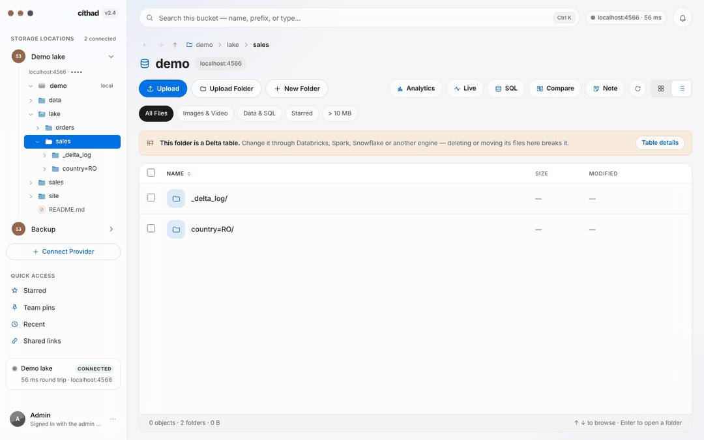

<p align="center">
  <picture>
    <source media="(prefers-color-scheme: dark)" srcset="docs/brand/jvinu-logo-white.svg">
    
  </picture>
</p>

# jvinu — Finder for your data lake, on any cloud

*jvinu* (say “zhvee-noo”) is Lojban for “view”: one view over every bucket, table and file you have, on any cloud.

A self-hosted, Finder-like interface for browsing, previewing, querying and managing files across object storage:
Amazon S3, Azure Blob Storage, Google Cloud Storage, Oracle Cloud, Cloudflare R2, Wasabi,
Backblaze B2, DigitalOcean Spaces, Dropbox, OneDrive and Google Drive — plus MinIO, local emulators such as Floci,
and an optional storage server of your own.

Credentials are encrypted in jvinu's database and only ever used on the server; the browser
sees file names, never keys. New connections start read-only, and jvinu sends no telemetry —
see [SECURITY.md](SECURITY.md).



Licensed under the [GNU AGPL-3.0](LICENSE).

## Install with Docker

```bash
cp .env.example .env
# set JVINU_SECRET (openssl rand -base64 48)
docker compose up -d                       # http://localhost:3000 — the app is at /dashboard
docker compose --profile storage up -d     # …plus your own storage, connected as "My storage"
docker compose --profile floci up -d       # …or S3/Azure/GCS/OCI emulators to try it on
```

Then open it: the first sign-in asks you to choose the admin password. It also asks for a
one-time setup code, which the server prints in its log (`docker compose logs jvinu`) with
a link that fills it in. That way, only someone who can read the server's log chooses the
password, not whoever reaches a new server first.

The image runs Next's standalone server as a non-root user, keeps its SQLite database on the
`/data` volume, and has a healthcheck on `GET /api/health`. Back up `/data` together with
`JVINU_SECRET`. For anything beyond localhost, put it behind a TLS-terminating reverse proxy
(session cookies are marked `Secure` when the proxy sends `X-Forwarded-Proto: https`).

`/` opens the app (the sign-in page until you're signed in). Only `/cookies`, the cookie policy,
and share links are public, and search engines are asked to stay away from everything. The
website at jvinu.com — landing page and storage guide — is a separate project.

### Configuration

| Variable | |
| --- | --- |
| `JVINU_SECRET` | **Required**, 32+ characters. Master key: every stored credential is encrypted under it (AES-256-GCM, HKDF sub-keys). Lose it and saved connections can't be read. |
| `JVINU_ADMIN_PASSWORD` | Optional. The sign-in password, 12+ characters. Leave it unset to choose the password in the browser at the first sign-in. When it's set, it always takes over, so it's also the way back in if you forget a password chosen in the browser. |
| `JVINU_OIDC_ISSUER`, `JVINU_OIDC_CLIENT_ID`, `JVINU_OIDC_CLIENT_SECRET` | Optional single sign-on (authorization code + PKCE). Register `<JVINU_PUBLIC_URL>/api/auth/oidc/callback` as the redirect URI. |
| `JVINU_OIDC_ALLOWED` | **Required with OIDC.** Comma-separated emails and `@domains` allowed in. While it's empty, the server doesn't start sign-in and the login page says why. |
| `JVINU_ADMINS` | SSO emails and `@domains` that are admins (manage connections and the storage plan); everyone else is a member. The admin password is always an admin. |
| `JVINU_OIDC_TRUST_UNVERIFIED_EMAIL` | `1` for a provider that never sends `email_verified` (Microsoft Entra); otherwise unverified emails aren't let in. |
| `JVINU_OIDC_ALLOW_ANY` | `1` to admit every account the provider signs in, with no allowlist. Only for a provider that holds nobody but your own people — never Google or another public provider. |
| `JVINU_PUBLIC_URL` | The external URL: the OIDC redirect, and the address in share links (without it, links use the address jvinu was opened at). |
| `JVINU_DATABASE_URL` | `postgres://…` to use Postgres instead of SQLite. |
| `JVINU_DATA_DIR` | Where the SQLite file lives (`/data` in the image, `.data` locally). |
| `JVINU_MAX_UPLOAD_MB` | Largest single upload (default 5120). |
| `JVINU_TRUST_PROXY` | `1` behind a reverse proxy, so sign-in throttling and share-link limits key on `X-Forwarded-For`. |
| `JVINU_THUMB_CACHE_MB` | Disk space for image thumbnails, under `JVINU_DATA_DIR/thumbs` (default 1024). |
| `JVINU_ZIP_MAX_GB` | The most one zip download may hold (default 50); it may also hold at most 10,000 files. |
| `JVINU_PREVIEW_MAX_MB` | The most one data preview may read (default 64). |
| `JVINU_SQL_MAX_MB`, `JVINU_SQL_MEMORY`, `JVINU_SQL_TIMEOUT_S`, `JVINU_SQL_THREADS` | Limits for SQL on files (defaults 1024 MB fetched, 1GB memory, 60 s, 2 threads) — see [docs/sql.md](docs/sql.md). |
| `JVINU_DEMO` | `1` for a public read-only demo with an "Explore the demo" button — see [docs/demo.md](docs/demo.md). |
| `JVINU_LAKE_CHECKPOINT_MAX_MB` | Largest Delta checkpoint read for a table's totals (default 256). |
| `JVINU_DUCKDB_MEMORY` | DuckDB's memory cap for previews (default `512MB`). |
| `JVINU_SCRATCH_DIR` | Scratch space for previews, cleaned after each (default: the system temp folder). |
| `JVINU_STORAGE_*` | Bundled storage (see below and [.env.example](.env.example)). |
| `JVINU_WAITLIST_URL`, `JVINU_WAITLIST` | Optional cloud-backup waitlist form in the account menu; off unless a URL is set. |
| `JVINU_DOMAIN`, `JVINU_BIND` | HTTPS with an automatic certificate: `docker compose --profile proxy` — see [docs/https.md](docs/https.md). |
| `JVINU_RESET_TWO_FACTOR` | `1` for one restart turns off two-step sign-in, if the phone and recovery codes are lost. |
| `JVINU_SMTP_URL`, `JVINU_MAIL_FROM` | Email for storage customers' notices and the seller's alerts. |
| `JVINU_STORAGE_STORE_URL` | Buy storage from a jvinu that sells it: adds **Storage plan** to the account menu — see [docs/sell-storage.md](docs/sell-storage.md). |
| `JVINU_SELLER_*` | Sell storage (€3 per 100 GB a month, VAT included) from Backblaze B2 or Wasabi, paid through Stripe — see [docs/sell-storage.md](docs/sell-storage.md) and the [legal templates](docs/legal/README.md). |

Backups: `scripts/backup.mjs` and `scripts/restore.mjs` — see [docs/backups.md](docs/backups.md).

With neither a password nor single sign-on configured, the first sign-in chooses the
password (see below).

## Signing in

- **Password:** one admin account. On a new server, the first sign-in chooses the password,
  and the name shown for it in each connection's history. It needs the one-time setup code
  from the server's log, and only its scrypt hash is kept. Change it from the account menu:
  that asks for the current one and signs out every other browser. Or set
  `JVINU_ADMIN_PASSWORD`, which always takes precedence. Attempts, setup codes included, are throttled (10 per 15
  minutes per address), and passwords are compared in constant time.
- **Single sign-on:** any OpenID Connect provider. Only verified emails on the allowlist get
  in. An empty allowlist doesn't mean "everyone": the server refuses to run SSO until you list
  who may sign in, or set `JVINU_OIDC_ALLOW_ANY=1` explicitly.

Sessions last 7 days, are stored hashed in the database, and every state-changing request
needs the session's CSRF token and a same-origin `Origin`.

The only cookies are the ones sign-in needs (the session, and the single sign-on handshake).
There's no tracking or analytics, so a short notice informs visitors instead of asking for
consent. `/cookies` lists every cookie and browser setting; `app/lib/cookies.ts` is that list,
and a test keeps it in step with the code.

Every signed-in user sees every connection: there are no roles or per-user scoping yet.

## Connecting storage

**Connect Provider** offers each service by name; the server checks the credentials can list
the bucket before saving anything, then stores them encrypted under `JVINU_SECRET`, bound to
the connection's ID. They're never sent back to the page.

| Service | You enter | Share links |
| --- | --- | --- |
| Amazon S3 (and MinIO, emulators) | access key, secret key; endpoint for anything but AWS | presigned |
| Azure Blob | storage account, account key, container | SAS (not on emulators) |
| Google Cloud Storage | service-account key JSON | signed with a key; emulators: served through the app |
| Oracle Cloud | namespace, region, tenancy & user OCIDs, fingerprint, API private key | served through the app |
| Cloudflare R2 | account ID (+ jurisdiction), access key, secret | presigned |
| Wasabi | region, access key, secret | presigned |
| Backblaze B2 | region, key ID, application key | presigned |
| DigitalOcean Spaces | datacenter, access key, secret | presigned |
| Dropbox | a folder (`/` for everything), app key, one-time access code | served through the app |
| OneDrive | a folder (`/` for everything), application (client) ID, sign-in code | served through the app |
| Google Drive | a folder (`/` for everything), OAuth client ID and secret, sign-in code | served through the app |

R2, Wasabi, B2 and Spaces use the S3 API with an endpoint the server builds from the account
ID or region. Share links last 15 minutes to 7 days, chosen per browser under **Copy Link**.
Where a provider can't sign one, files stream through jvinu to signed-in users.

Mark a connection **read-only** when connecting, or with the padlock in the sidebar: every
write is then refused by the server, not just hidden.

### Dropbox

Create an app with **Scoped access** in the [Dropbox App Console](https://www.dropbox.com/developers/apps),
enable `files.metadata.read` and `files.content.read` (plus `files.content.write` to make
changes), and leave PKCE on. In Connect Provider, enter its app key, click **Allow access on
Dropbox**, approve, and paste the code. The server trades it for a refresh token — no app
secret, no callback URL — and keeps only that and the app key.

### OneDrive

Personal OneDrive and OneDrive for Business, through Microsoft Graph. In the
[Microsoft Entra admin center](https://entra.microsoft.com) → **App registrations**, register an
app (no redirect URI), turn on **Allow public client flows** under Authentication, and copy its
**Application (client) ID**. In Connect Provider, enter that ID, click **Sign in with Microsoft**,
type the code shown into the Microsoft tab, approve, then click **Connect**. Leave **Tenant**
empty for an app that allows any account; use `consumers` for a personal-accounts-only app, or
your tenant ID for a single-organisation app.

This is the device-code flow — no client secret, no callback URL — and the app asks for
`Files.ReadWrite`, `offline_access` and `User.Read`. The server keeps only the client ID, tenant
and a refresh token. Microsoft replaces that token on every use and the newest is saved; a
connection left unused for about 90 days has to be signed in again. Deleted items go to the
OneDrive recycle bin. Folder totals and analytics walk the tree folder by folder (Graph has no
recursive listing), so deep trees take longer than on S3; OneNote notebooks and items shared from
other drives aren't listed.

### Google Drive

"My Drive" of one Google account, through the Drive API. In [Google Cloud](https://console.cloud.google.com):

1. Pick or create a project and enable the **Google Drive API** (APIs & Services → Library).
2. Set up the **OAuth consent screen**. While its publishing status is **Testing**, add your Google
   account under **Test users**; Google then expires its sign-ins after 7 days, so publish the app
   (it can stay unverified for your own use) to keep a connection working.
3. Under **Credentials**, create an **OAuth client ID** of type **Web application**, and add this
   server's sign-in page as an **Authorized redirect URI**: the address you open jvinu at, followed by
   `/connect/google-drive` (for example `https://storage.example.com/connect/google-drive`, or
   `http://localhost:3000/connect/google-drive` on your own machine).

In Connect Provider, enter the client ID and secret, click **Sign in with Google**, approve, and
paste the code the page shows into **Sign-in code**, then click **Connect**. It's the
authorization-code flow with PKCE: the code is useless without the verifier, which never leaves
the form. The app asks for the `drive` scope. The server keeps, sealed, only the client ID,
secret and a refresh token.

Google Docs, Sheets, Slides and Drawings are listed with `.pdf` added and open as a PDF export.
Deleted items go to the Drive bin. Two things Drive allows that paths can't show are left out:
names containing `/`, and a second file of the same name in the same folder (the oldest is shown).
Folder totals walk the tree folder by folder; shared drives and "Shared with me" aren't listed.

### Testing with Floci

Every provider except Dropbox, OneDrive and Google Drive has **Use Floci defaults** in the connect dialog. Start the
emulators with `docker compose --profile floci up -d` (or `floci start`, `floci az start`,
`floci gcp start`, `floci oci start`); the bucket must already exist. Floci doesn't verify keys
or signatures, so credential errors can only be tested against the real clouds.

## Run your own storage

`docker compose --profile storage up -d` adds a single-node [Garage](https://garagehq.deuxfleurs.fr)
server. jvinu sets it up on first start — layout, an access key, a `my-files` bucket — and
connects it as **My storage**, which can't be disconnected from the UI. Restarts and re-runs
create nothing twice. The sidebar shows disk use; a banner warns at 85% full and uploads
stop at 95%. One disk means no redundancy, so back it up.

Details — where data lives, backups, using it from other tools, remote access — are in
[docs/run-your-own-storage.md](docs/run-your-own-storage.md).

## What it does

- Browse with breadcrumbs, a sidebar tree of folders and files, Back / Forward / Up (`⌘↑`), and
  the location in the URL
- Search a whole bucket (`⌘K`) on the server — every folder, not just the ones you've opened
  (the first 100,000 objects; up to 500 matches shown) — plus sort, list and grid views and
  quick filters
- Stars and recently opened files, saved per user on the server; they follow objects that are
  moved or renamed and disappear with deleted ones
- Quick Look inspector: previews of images, video, audio, PDFs and text/code (the first
  256 KB), metadata, folder totals, share links. Files served through the app support HTTP
  Range requests, so video seeks and downloads resume
- Select files and folders and delete, rename, move or copy them — nothing is silently
  overwritten. These run as background jobs with live progress and Cancel (up to 100,000
  objects each, 8 at a time); S3 copies above 5 GB go part by part
- Upload many files or whole folders, by picker or drag and drop; uploads stream to the cloud
  in parts with per-file progress
- Download a folder or a selection as one zip, streamed as it's read: folders and non-ASCII
  names kept, ZIP64 past 4 GB, media stored as it is and the rest compressed. Up to 10,000
  files; closing the download stops the reads
- Thumbnails: grids and the inspector show a 512 px WebP made once per file version and
  cached on disk (LRU, size-capped), so a folder of photos downloads each original at most once
- **Share links** served by jvinu, on every provider: expiry, a download limit, an optional
  password (wrong guesses back off), and revoke. Downloads hand off to a short signed link where
  the provider makes one, and stream through jvinu otherwise; the recipient's page never
  renders the file. **Shared links** lists each link with its download count
- **Share bucket:** mark one connection "share from here", and links to files elsewhere are
  served from a copy there (made once per file version, deleted when its links end), where
  downloads cost less. Direct provider-signed links remain an option
- Cost before you click: about how much a download or share costs (egress and retrieval
  fees, per provider and storage class, or a rate you set), and a warning before reading from
  archive classes
- **Encryption:** turn on the provider's at-rest encryption per connection where it's optional
  (S3, Backblaze B2), and see each file's status. Or encrypt with your own passphrase:
  **jvinu encryption** stores only ciphertext, in rclone's crypt format, so rclone can read it
  too — see [docs/encryption.md](docs/encryption.md)
- A public base URL per connection, for a CDN or custom domain in front of a public bucket:
  each file gets a correctly encoded public URL to copy — see [docs/cdn.md](docs/cdn.md)
- **Analytics** per bucket or folder: size, object count, growth by month, breakdown by file
  type, storage class and folder, largest files, and an estimated monthly cost from list
  prices — or a rate you set per connection
- **Data previews:** Parquet, CSV, TSV, JSON, JSON Lines (gzipped too) and Avro open as a
  table — columns, types, row count and the first 100 rows — read by a built-in DuckDB from a
  small part of the file: a Parquet preview fetches the footer and first pages, not the file
- **Delta, Iceberg and Hudi tables** are recognised as tables: a banner while you're inside
  one, and its version, files, rows, schema, partitions and history, read from its own
  metadata. Deleting, moving or renaming files in a table — or uploading into one — stops
  first to say what it breaks, and goes ahead only if you confirm
- **SQL on files:** `SELECT … FROM 'sales/**/*.parquet'` over Parquet, CSV and JSON on any
  provider, run by DuckDB in a sandbox that sees only the files the query names; save results
  back as Parquet, CSV or JSON Lines — see [docs/sql.md](docs/sql.md)
- **Quick Look** on the space bar: images, video, PDFs, code with syntax highlighting, Markdown
  and data tables full size, ← → to step through the folder
- **Live folders** re-list every few seconds and mark new files as they land
- **Compare** two folders — on one connection or two different clouds — by path, size and
  checksum, then copy what's missing or different; copy any selection to another connection
- **Bulk metadata:** Content-Type, Cache-Control, Content-Disposition, storage class and tags
  on many files at once, as a background job
- A folder's **README** shows above its listing; **notes** on folders ("don't delete — the
  nightly export writes here") and **team pins** are shared with everyone on the server
- **History** of each connection, for the whole bucket or one folder: who uploaded, created,
  copied, moved, renamed or deleted what, and when, and how each job went; share links made,
  revoked and downloaded; zip downloads; changes to the connection itself.
  It's kept in the server's database for 180 days. Browsing, previews and single downloads
  aren't recorded
- Light and dark mode; motion that respects "reduce motion"

## Development

```bash
npm install --include=dev   # dev deps are needed even if NODE_ENV=production in your shell
npm run dev                 # http://localhost:3000
```

`.env.local` needs `JVINU_SECRET`. Without `JVINU_ADMIN_PASSWORD` or OIDC, the first sign-in
asks you to choose a password, and the setup code is printed in the terminal running
`npm run dev`. Checks: `npm run lint`, `npm run typecheck`, `npm run build`, `npm test`.

### Tests

- `tests/drivers.contract.test.ts` — the same contract (verify, listing, paging past 1,000
  entries, uploads, copy, rename, delete, inventory, links) run against every driver: the Floci
  emulators, a Garage server (`JVINU_TEST_GARAGE_TOKEN`), and Dropbox via an in-memory mock of
  its API (`tests/dropbox-mock.ts`) — or a real account with `JVINU_TEST_DROPBOX_APP_KEY` and
  `JVINU_TEST_DROPBOX_REFRESH_TOKEN`. OneDrive likewise: a mock of Microsoft Graph
  (`tests/onedrive-mock.ts`), or a real account with `JVINU_TEST_ONEDRIVE_CLIENT_ID` and
  `JVINU_TEST_ONEDRIVE_REFRESH_TOKEN`; `tests/onedrive.test.ts` covers its sign-in, upload
  sessions and token rotation. A service that isn't running is skipped unless
  `JVINU_CONTRACT_REQUIRED=1`.
- `tests/bundled-storage.test.ts` — bootstrapping My storage against a real Garage: first run,
  re-runs, a reset volume, a changed master key, disk thresholds.
- `tests/auth.test.ts`, `tests/pricing.test.ts` — the OIDC allowlist and the cost estimates.
- `tests/crypt.test.ts` — the rclone crypt format against files rclone wrote; with
  `JVINU_TEST_RCLONE=1` (and Docker), rclone itself decrypts what jvinu wrote. The contract
  suite also runs through the encryption wrapper on S3 and Dropbox, and against rclone on the
  same bucket.
- `tests/shares.test.ts`, `tests/share-copies.test.ts` — share-link limits, hashing and password
  back-off, delivery on every kind of provider; the share bucket's copies, reuse and clean-up.
- `tests/thumbs.test.ts`, `tests/public-url.test.ts`, `tests/zip.test.ts`, `tests/zip-plan.test.ts` —
  the thumbnail cache; public URLs fetched from the emulators; zip archives checked with Python's
  zipfile and Info-ZIP (ZIP64 past 4 GiB, flat memory, cancel), and zip limits.
- `tests/data-preview.test.ts`, `tests/lake-tables.test.ts`, `tests/sql.test.ts` — previews
  checked against DuckDB reading whole files; Delta and Iceberg totals against delta-rs and
  PyIceberg; the table guard; SQL globs, the sandbox and saving results.
- `tests/compare-transfer.test.ts`, `tests/operations-metadata.test.ts` — comparing and
  copying across connections, and bulk metadata.
- `scripts/smoke-storage.sh` — the storage profile end to end in Docker, from a clean start.

CI (`.github/workflows/ci.yml`) runs lint, typecheck and build; the tests against Floci and
Garage; the storage smoke test; and a Docker build that must report healthy. It runs once the
project is pushed to a GitHub repository.

## Shape of the app

| Path | What's there |
| --- | --- |
| `app/robots.ts` | Asks search engines to stay away: this is an app, not a website. |
| `app/login/` | Sign-in: admin password and/or SSO. |
| `app/dashboard/page.tsx` | The app, behind sign-in. Old `/?bucket=…` links redirect here (`next.config.ts`). |
| `proxy.ts` | Sends signed-out requests for `/dashboard` to `/login`; API routes check sessions themselves. |
| `instrumentation.ts` | Starts the bundled-storage bootstrap and the share-bucket sweeper when the server boots. |
| `app/s/[token]/` | The public share-link page and its download route. |
| `app/components/storage-explorer.tsx` | The stateful shell: location, search, sort, selection, uploads, drag and drop. |
| `app/components/sidebar.tsx`, `symbols.tsx` | Connections, the folder-and-file tree, disk meter, quick access. |
| `app/components/file-table.tsx`, `file-grid.tsx`, `detail-panel.tsx` | The two listing views and the Quick Look inspector. |
| `app/components/add-provider-dialog.tsx` | Connect a provider, including Dropbox's PKCE step and Floci defaults. |
| `app/components/operation-dialogs.tsx` | Rename, move/copy destination picker, delete confirmation. |
| `app/components/analytics-dialog.tsx` | Size, growth, composition and cost of a bucket or folder. |
| `app/components/share-dialog.tsx`, `shared-links-view.tsx` | Creating share links (and direct ones); the Shared links view. |
| `app/components/connection-settings-dialog.tsx`, `zip-dialog.tsx` | Per-connection settings (encryption, share bucket, public URL); zip downloads. |
| `app/components/account-menu.tsx`, `waitlist-dialog.tsx` | Profile menu: appearance, the optional waitlist, sign out. |
| `app/lib/storage.ts`, `remote.ts` | The client's object model, provider presets, helpers, and calls to the API. |
| `app/lib/queries.ts`, `components/query-provider.tsx` | TanStack Query: one cache for folder listings (paged with `useInfiniteQuery`), search, saved items, disk status and previews; writes refresh what they touched by key. |
| `app/components/use-virtual-list.ts` | TanStack Virtual for the file table and grid: only rows near the viewport are rendered, however big the folder. |
| `app/lib/pricing.ts` | List prices, storage and download cost estimates (the website's storage guide uses a copy). |
| `app/lib/connection-settings.ts`, `public-url.ts` | Per-connection settings; public URLs for a CDN in front of a bucket. |
| `app/lib/server/db.ts`, `crypto.ts` | SQLite or Postgres with migrations; master-key encryption. |
| `app/lib/server/auth.ts`, `oidc.ts`, `guard.ts` | Sessions, CSRF, throttling, OIDC and its allowlist, per-route checks. |
| `app/lib/server/connections.ts` | Saved connections, including server-managed ones. |
| `app/lib/server/drivers/*` | One `StorageDriver` per service: S3 (and S3-compatible), Azure, GCS, OCI, Dropbox, OneDrive — and `crypt.ts`, which wraps any of them for jvinu encryption. |
| `app/lib/server/crypt.ts` | The rclone crypt file format: keys, blocks, sizes, ranges. |
| `app/lib/server/thumbs.ts` | Thumbnails and their disk cache. |
| `app/lib/server/shares.ts`, `share-access.ts`, `share-serve.ts`, `rate-limit.ts` | Share links: storage, limits and passwords, delivery, request limits. |
| `app/lib/server/share-copies.ts` | The share bucket: copies, reuse and the sweeper. |
| `app/lib/server/zip.ts`, `zip-plan.ts` | The streaming ZIP writer; planning a zip download within its limits. |
| `app/lib/server/operations.ts`, `jobs.ts` | Delete / copy / move / rename: quick checks up front, then a background job with progress and cancel. |
| `app/lib/server/inventory.ts` | The flat object list behind search and analytics, cached briefly and forgotten on writes. |
| `app/lib/server/user-items.ts`, `notes.ts` | Per-user stars and recent files, team pins; folder notes. |
| `app/lib/server/activity.ts` | Each connection's history: recording, runs folded into one line, pruning after 180 days. |
| `app/lib/server/data/*` | Data previews (Parquet footer and pages, CSV/JSON prefixes, Avro blocks), Delta/Iceberg/Hudi tables, SQL on files — all on an embedded DuckDB. |
| `app/lib/server/transfer.ts`, `compare.ts` | Copies between connections; comparing two folders. |
| `app/components/quick-look.tsx`, `viewers/*` | Quick Look; the code and Markdown viewers it shares with folder READMEs. |
| `app/components/sql-console.tsx`, `compare-dialog.tsx`, `metadata-dialog.tsx`, `folder-header.tsx`, `data-preview-dialog.tsx`, `lake-table.tsx` | SQL, compare, bulk metadata, folder notes and READMEs, data previews, lake tables. |
| `app/lib/server/bundled-storage.ts` | My storage: Garage bootstrap through its admin API, disk status. |
| `app/lib/server/vault.ts`, `legacy.ts` | Short-lived sealed values (the OIDC flow cookie), and a one-time import of connections saved by pre-v1 versions. |
| `app/lib/server/waitlist.ts` | Forwards waitlist sign-ups, when configured. |
| `app/lib/server/store/*`, `storage-plan.ts`, `app/components/storage-plan-dialog.tsx` | Selling storage (Stripe, B2/Wasabi buckets, quotas) and buying it (the managed Cloud storage connection). |
| `app/api/**` | Sign-in, session, health, waitlist, saved items (`/api/me/items`), jobs (`/api/jobs`), share links (`/api/shares`); per connection: list, search, upload, operations, stats, analytics, disk, links, share links, zip, thumbnails, metadata, history, object proxy (with Range). |
| `storage/`, `docs/` | Garage config and secrets script; guides to running your own storage, encryption, and a CDN in front of a bucket. |
| `app/globals.css` | Design tokens for light and dark, frosted materials, motion. |

## Status

The self-hosted v1 roadmap is complete: database persistence with a master key, password and
OIDC sign-in, file operations and read-only connections, streamed uploads and paging, preview
sandboxing and security headers, Docker packaging, and driver contract tests in CI — plus
Dropbox, OneDrive, bundled storage, analytics and the storage guide; thumbnails, cost
previews, provider and jvinu encryption, share links with limits, the share bucket, public
URLs, zip downloads, and each connection's history.

Not yet: roles and per-user connections, OIDC tested against a live identity
provider, and the Dropbox and OneDrive drivers tested against live accounts (they're covered by mocks).
Background jobs live in the server process: a restart marks running ones "interrupted"
rather than resuming them.


## Licence

jvinu is free software under the [GNU Affero General Public License v3.0](LICENSE). You may
run, study, change and share it; if you run a modified version as a network service, you must
offer its source to the people using it.
